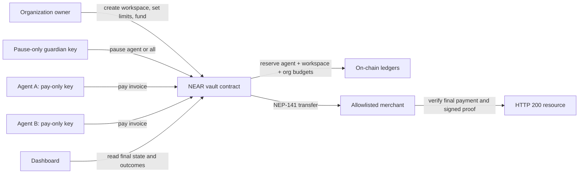

# Orbit architecture and security boundary

Orbit runs one operator-owned NEAR vault per organization. Version 1.1 partitions its daily budget into owner-created workspaces. An agent belongs to one workspace for the lifetime of its key. The contract holds one NEP-141 token and is the only component that can release it to an allowlisted merchant.

## Payment sequence

1. The merchant returns an `orbit-near` HTTP 402 invoice naming the vault, merchant, token, price, expiry, resource and unique payment ID.
2. The agent checks the invoice against its configured merchant and maximum amount. Its NEAR function-call key can invoke only `pay` on the vault.
3. The vault checks replay, expiry, pause, allowlist, per-payment, agent, workspace, organization and available-balance rules in one NEAR receipt. A valid payment reserves all three budget levels before any token transfer.
4. The NEP-141 transfer executes. The private callback settles all three reservations as paid or refunds them on failure. A payment ID is never reused after an accepted transfer attempt.
5. The merchant serves the resource only after checking final vault `payment(id)`, the final `payment_paid` event in the signed transaction, and the agent's resource-bound proof.

## Authority and trust

- The **owner** may register agents, change limits and merchant allowlists, fund or withdraw the available vault balance, resume, and upgrade the contract. This is an operator-controlled treasury, not an immutable or trustless customer vault.
- An **agent key** can call only `pay`; it cannot change a limit, choose an unlisted merchant, withdraw or upgrade. The contract checks policy even if an agent host is compromised.
- The **guardian key** can only pause; it cannot spend or resume. The owner can also pause and is the only actor that can resume.
- The **merchant** and agent host are operator-run in the current demo. The diagnostic's source is public NEAR RPC data. Neither an independent buyer nor commercial demand is demonstrated.
- **Testnet funds** are open-mint `otusd` tokens with no monetary value. The merchant protocol is `orbit-near`, not proven x402 v2 `exact` compatible.

## State and deployment

Version 1.1 adds workspace fields to Borsh-encoded vault and agent state. Deploy it to a fresh account; do not install it over version 1.0 state. The old version 1.0 testnet vault remains a separate historical proof. Current version 1.1 evidence and public RPC verification commands are indexed in [evidence/README.md](evidence/README.md).
