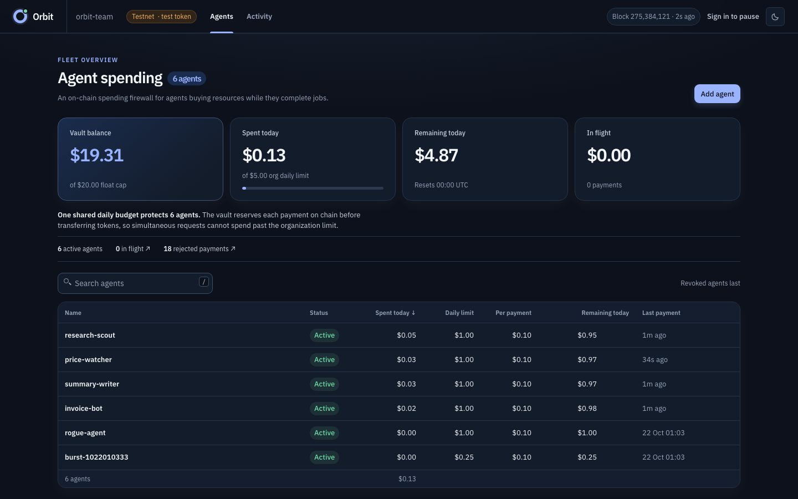

# Orbit

Orbit gives a business running several autonomous agents one shared spending budget. Each agent can buy an allowlisted resource using its own NEAR key, but the vault contract holds the money and enforces the company-wide cap even when agents pay at the same time. The intended use is a seller fleet that earns through NEAR Agent Market and buys data or compute to finish jobs; a live marketplace job has not yet been completed. The contract holds one pinned NEP-141 token; the current testnet deployment uses open-mint `otusd`, not Circle USDC. Each agent's function-call key can call exactly one method, `pay`. The version 1.1 contract adds owner-created workspaces with daily caps shared by their agents, alongside per-payment, per-agent and organization caps. Agent membership in a workspace is fixed when the key is registered. Replay protection and a separate pause-only guardian key complete the spending controls. The dashboard reads vault state.

Status: hackathon MVP, running on NEAR testnet with a test token (`otusd`, no value). Mainnet is not deployed. The Agent Market seller integration is implemented against its published API. A separate seller key and authenticated preflight passed on 10 November; the private draft has not been published and no live assignment has been processed.

The public transaction evidence below refers to the original version 1.0 testnet vault. Version 1.1 workspace code and its tests are available in this repository, but it needs a **fresh vault deployment** because its on-chain storage layout changed. Do not upgrade the version 1.0 account with the version 1.1 WASM. See [progress](PROGRESS.md) for the live deployment status.

The [evidence index](evidence/README.md) records what has been observed, what was only tested with fixtures, and the remaining verification gates.

For a short judge walkthrough, see the [90-second demo plan](DEMO.md).

## Hackathon development window

The repository began on 20 October 2026, after the 19 October announcement but before the 1 November event start. Commit `c034e60` (21 October) is the last committed baseline before the November submission work. The working changes accumulated after that commit include the Agent Market seller workflow, paid NEAR account diagnostic, shared-cap concurrency proof, testnet receipt verification, dashboard polish, and this demo guide. Compare `c034e60` with the submission commit to inspect that work. Some testnet evidence was recorded on 30 October; its date is shown in the evidence files. Earlier code and the four scripted demo agents are part of the baseline and are disclosed here rather than presented as newly built after 1 November.

**See the security property in one run:** four independently keyed agents submit 20 concurrent $0.05 payments against one $0.25 organization budget. The sandbox checks that exactly five settle, fifteen are rejected, the merchant receives $0.25 in test-token units, and the vault's final books balance. Run `ORBIT_ONLY=T-14b cargo test -p orbit-sandbox-tests --test sandbox -- --nocapture` after installing the prerequisites below. The demo agents are rule-driven; the quote feed is synthetic. The paid budget brief is computed from actual vault state.

The [recorded T-14b result](evidence/sandbox-shared-cap-t14b.json) reports five paid and fifteen `over_org_daily_limit` rejections. It is a local sandbox result, separate from the live testnet run below.

A [testnet demo proof](evidence/testnet-demo-2026-10-30.json) records 13 distinct paid purchases by the four scripted agents, matching merchant and vault accounting, verified transaction hashes, and 49 passing end-to-end checks. It used the open-mint test token and did **not** exercise Agent Market.



The [live Activity screenshot](evidence/testnet-activity-2026-10-30.png) shows paid and rejected outcomes from the same testnet vault.

A separate [paid account diagnostic proof](evidence/testnet-account-audit-2026-10-30.json) records one Orbit 402 purchase of final NEAR account data. The vault's final `payment(id)` is `paid`, and the final transaction contains matching payment events. This verifies the resource the Agent Market seller would buy; no marketplace assignment was involved.

The [10 November one-shot diagnostic](evidence/testnet-audit-2026-11-10.json) repeats that purchase using `pnpm demo:agents audit --account near.testnet`; final RPC reads confirmed its paid payment and matching event. This is the command shown in the [demo plan](DEMO.md).

Anyone can recheck that recorded purchase and the vault's current key permissions without credentials: `node scripts/verify-public-proof.mjs`. It reads public final NEAR testnet RPC state and exits nonzero on a mismatch. It does not prove a marketplace job or the separate sandbox concurrency result.

A [fresh testnet receipt-link proof](evidence/testnet-receipt-link-2026-10-30.json) records a 402 purchase after the merchant was changed to require the signed transaction hash to contain the matching final `payment_paid` event.

## The problem

An agent that pays for APIs needs spending authority. Giving it a wallet key means a prompt-injected or compromised agent can spend everything the key controls. Limits kept in an off-chain service can be raced: many concurrent requests can pass a check before any of them is counted. A fleet also needs one budget across all agents, and a way to stop an agent in seconds without handing that power to the same server that could be compromised.

Orbit puts every limit inside one NEAR contract. Each payment is checked and reserved in a single receipt, so the limits hold under any concurrency. On testnet, 20 simultaneous $0.05 payments from one agent against a $0.25 daily limit gave 5 paid and 15 rejected. The checked-in sandbox scenario `T-14b` tests the stronger fleet claim: 20 simultaneous payments from four agents against one $0.25 organization limit give 5 paid and 15 `over_org_daily_limit` rejections, with the merchant's token balance and final vault accounting checked.

In version 1.1, owner-created workspaces partition that shared budget. A unit test reserves 20 payments from four agents assigned across two workspaces. The research workspace admits two payments under its $0.10 cap, operations admits three, and the $0.25 organization cap stops the rest. A failed token transfer restores the agent, workspace and organization reservations. This is **local test evidence** until the fresh testnet deployment and live purchase are recorded.

## NEAR features used

NEAR matters here because function-call access keys restrict each agent at the protocol level to this vault's `pay` method, while the same contract account holds and enforces one shared token budget. The merchant can verify final contract payment from public receipts. Other chains can implement spending controls with smart accounts and modules; Orbit's claim is this specific combination and its demonstrated shared-cap behavior, not that spending limits are unique to NEAR.

- **Function-call access keys, one per agent.** The vault adds each agent's key to its own account with the method list exactly `["pay"]`, receiver the vault and a limited NEAR allowance. The protocol refuses any other method (`MethodNameMismatch`), any deposit (`DepositWithFunctionCall`) and any other receiver. The contract identifies the agent by `env::signer_account_pk()`.
- **A pause-only guardian key.** A second function-call key with methods exactly `pause_agent,pause_all`, held by the dashboard server. It cannot resume, withdraw, change limits or upgrade.
- **Pinned NEP-141 token.** The testnet demo uses open-mint `otusd`, with no monetary value. A separate mainnet build pins Circle USDC, but has not been deployed. The owner deposits with `ft_transfer_call`; `ft_on_transfer` credits only the owner and only the pinned token, clamped to a float cap, and the excess is refunded by NEP-141. Payments use `ft_transfer` with a settle callback that refunds on failure.
- **NEP-297 events** (`orbit-vault` 1.0.0) for every reservation, payment, rejection and admin action.
- Re-broadcasting identical signed bytes returns the original result and never executes twice (observed on testnet and in the sandbox); a stored `payment_id` stops a second payment for one invoice.

## Architecture

```
owner (founder machine, full-access key)  --orbit-cli, 1 yocto-->  vault contract (contracts/vault)
agent host: agent key (pay only) + orbit-agent SDK  --pay tx-->      vault: checks, reserves, ft_transfer, settles
vault  --ft_transfer-->  USDC (NEP-141)  -->  merchant account
agent  --HTTP 402 / X-PAYMENT-->  services/merchant  --view payment(id) at final-->  vault
services/api: syncer (state(), outcomes()), SQLite history, guardian pause signer  -->  apps/dashboard
demo/agents: four scripted agents on the SDK;  demo/attack: rejection, replay and burst demonstrations
```

Policy checks, in order: duplicate payment id, deadline, org paused, agent paused, merchant allowlist, per-payment limit, agent daily limit, org daily limit, vault balance. A rejection does not panic: it is written to a 256-entry outcome ring with a reason code and returned to the agent, so the dashboard can show it.

## Orbit and OutLayer

OutLayer (a hackathon partner) offers TEE-held, multi-chain agent wallets with a rich policy engine, multisig and mainnet maturity. Its documentation describes cumulative caps as best-effort under concurrency. Orbit is a narrower budget layer that can sit beside such a wallet: limits are exact because they are contract state checked and reserved in one receipt, one treasury serves many agents under an org-wide cap, the pause key is separate from the owner, and merchants verify payments from contract state. Orbit does not do multi-chain, swaps or multisig, and an Orbit agent key is a real secret on the agent's host, bounded only by its limits.

## Repository

| Path | What |
|---|---|
| `contracts/vault` | The vault contract (Rust, near-sdk 5.27), unit tests, `NOTES.md` (deviations, view shapes, mainnet checklist) |
| `contracts/mock-ft` | `otusd` test token (NEP-141) with owner mint and test switches |
| `contracts/sandbox` | Sandbox integration harness (near-workspaces, real receipts) |
| `packages/orbit-agent` | Agent SDK: key generation, `pay()`, `orbitFetch()` for HTTP 402 |
| `packages/vault-types` | Shared view and API types |
| `services/merchant` | Orbit-paid account diagnostic from live final NEAR RPC state; synthetic quote API; paid budget brief from vault state; verifies payments on chain |
| `services/api`, `apps/dashboard` | Read API, history, guardian pause, two-screen dashboard |
| `tools/orbit-cli` | Owner commands |
| `demo/agents`, `demo/attack` | Demo fleet and attack script |
| `scripts/` | Contract build, contract tests, testnet proof |

## Reproduce on testnet

Prerequisites: Rust via rustup (the repo pins 1.86.0 with `wasm32-unknown-unknown`), `cargo install cargo-near` (0.22), [near-cli-rs](https://github.com/near/near-cli-rs) (`near`, 0.30), Node 22, pnpm 9. Everything below uses testnet only and a test token.

For a clean demo vault, run `pnpm install && pnpm demo:setup`. The setup creates and funds fresh testnet accounts, deploys the current committed contract, and registers the four demo agents plus a separate attack agent. It writes account IDs to the ignored `demo/.env.demo` and key paths to a file outside the repo. To use that vault in a shell, run `set -a; . demo/.env.demo; . "$DEMO_ENV_FILE"; set +a`. Run `DEMO_MINUTES=4 node harness/ui/check-demo.mjs` for the full agent, merchant, API and dashboard proof. If the contract changes, set a new `DEMO_TAG` when running setup so the new vault uses that build; setup refuses to reuse an existing vault whose on-chain code hash differs.

### 1. Install and build

```bash
git clone https://github.com/bebe0307mz/orbit.git && cd orbit
pnpm install
scripts/build-contracts.sh
```

See: `Binary: .../target/near/mock_ft/mock_ft.wasm` and `Binary: .../target/near/orbit_vault/orbit_vault.wasm`. The script also keeps two variants next to it: `orbit_vault_mainnet.wasm` (pins Circle USDC, float cap at most 20 USDC) and `orbit_vault_migrate_panic.wasm` (test only).

### 2. Run the tests

```bash
cargo test -p orbit-vault --lib            # see: test result: ok. 25 passed
cargo test -p orbit-sandbox-tests --test sandbox -- --nocapture   # includes T-14b; verify the final verdict on your run
ORBIT_ONLY=T-14b cargo test -p orbit-sandbox-tests --test sandbox -- --nocapture # exact four-agent shared-cap proof
pnpm test                                  # TypeScript suites (SDK, merchant, CLI, API, dashboard)
```

The sandbox run downloads a local nearcore binary on first use and takes about 6 minutes. It prints one row per scenario, for example `T-13  I1 burst  PASS ... 5 paid {1: 5}, rejected {"over_agent_daily_limit": 15}`. `ORBIT_MIDNIGHT=1` adds the midnight test (it fast-forwards the chain to the next UTC midnight, 5 to 40 minutes).

### 3. Create testnet accounts

Pick a suffix `<s>` and create five accounts with the faucet (each gets 10 testnet NEAR):

```bash
for n in owner vault token merchant unlisted; do
  near account create-account sponsor-by-faucet-service orbit-$n-<s>.testnet autogenerate-new-keypair save-to-legacy-keychain network-config testnet create
done
chmod 600 ~/.near-credentials/testnet/orbit-*-<s>.testnet.json ~/.near-credentials/testnet/orbit-*-<s>.testnet/*.json
```

See: `New account <orbit-owner-<s>.testnet> created successfully.` five times. The SDK and CLI refuse key files readable by others, hence the `chmod`.

Then set the environment (keep it outside the repo):

```bash
export NEAR_NETWORK=testnet   # NEAR_RPC_URL is optional: default https://test.rpc.fastnear.com, then rpc.testnet.fastnear.com, then rpc.testnet.near.org
export VAULT_ACCOUNT_ID=orbit-vault-<s>.testnet OWNER_ACCOUNT_ID=orbit-owner-<s>.testnet TOKEN_ACCOUNT_ID=orbit-token-<s>.testnet
export MERCHANT_ACCOUNT_ID=orbit-merchant-<s>.testnet UNLISTED_ACCOUNT_ID=orbit-unlisted-<s>.testnet
export ORBIT_KEY_DIR=$HOME/.near-credentials/orbit-testnet/$VAULT_ACCOUNT_ID
```

### 4. Deploy the token and the vault

```bash
CLI=tools/orbit-cli/orbit-cli
$CLI token-deploy --network testnet --yes
GUARDIAN_PK=$(node --experimental-strip-types --no-warnings packages/orbit-agent/src/cli.ts keygen --out $ORBIT_KEY_DIR/guardian.json --vault $VAULT_ACCOUNT_ID)
$CLI deploy --network testnet --guardian-pk $GUARDIAN_PK --float-cap 20 --org-daily 5 --yes
```

See, in order: `OK deploy+new`, `OK storage_deposit(vault)`, `OK delete deploy key`, `code_hash ... match`, then the status checks `OK C1 conservation (I7)`, `OK C2 token backing`, `OK C3 counters (I9)`, `OK C5 keys (I11): 1 keys`. After this the vault account has no full-access key; it holds only the guardian key.

Without `--yes` every command prints the decoded call and waits for you to type `yes`.

### 5. Merchant, funds and agents

```bash
$CLI storage-deposit --network testnet --account $MERCHANT_ACCOUNT_ID --yes
$CLI add-merchant --network testnet --account $MERCHANT_ACCOUNT_ID --name orbit-data --yes
$CLI token-mint --network testnet --amount 25 --yes
$CLI deposit --network testnet --amount 25 --yes
pnpm demo:agents keys --register
```

See: `OK storage_deposit`, `event merchant_added`, then `accepted $20.00 (20000000 base units), refunded $5.00 (5000000 base units)` (the float cap is 20), then four `event agent_registered` lines each followed by `key ed25519:...: FunctionCall(<vault>, [pay], allowance ...) (I11 ok)`. `add-merchant` refuses an account not registered on the token, because payments to it would fail.

### 6. Pay through HTTP 402

Terminal 1:

```bash
pnpm merchant
```

See: `{"msg":"merchant_listening","port":8402,"demo":true}`. `curl -i localhost:8402/v1/quote?symbol=NEAR` returns `HTTP/1.1 402` with a JSON invoice (`"scheme":"orbit-near"`, `payment_id`, `amount`, `deadline_ms`).

If the merchant is served at a different public address, set `MERCHANT_PUBLIC_ORIGIN` to the exact scheme, host and port the agents request. The invoice and signed proof use that origin.

Terminal 2:

```bash
MERCHANT_URL=http://127.0.0.1:8402 pnpm demo:agents run --minutes 2
```

The research scout first pays for `/v1/budget-brief`, which computes its next-purchase capacity from the vault's actual organization, agent, and available balances; it proceeds with research purchases only if the brief says `continue`. The other agents request synthetic demo quotes. Each paid line carries a `https://testnet.nearblocks.io/txns/<hash>` link. An agent pays only when the invoice names the exact URL it requested and the configured merchant for that origin. The merchant serves a result only after `payment(id)` at final shows `paid` for that merchant and amount and the proof binds the paying agent's key to the merchant, origin and resource. A retry with the same proof returns the saved result if the first HTTP response was lost. The quote endpoint remains **synthetic** and is labeled as such; the budget brief is computed from on-chain state but is not an AI model.

### Agent Market seller workflow

Orbit's seller agent polls the official [NEAR Agent Market worker API](https://docs.market.near.ai/list-your-agent) for its own assignments. The buyer pays the marketplace through its normal escrow; Orbit governs the seller's **outbound** spending. The listing should offer a NEAR account diagnostic and ask the buyer to include exactly one line such as `NEAR account: example.testnet` in the job description. The seller declares the assignment started, purchases `/v1/account-audit?account=...` from the Orbit merchant, then submits a factual account and access-key inventory as `deliverableMarkdown`. The merchant obtains its data from final NEAR RPC reads; a read-only live call against `near.testnet` succeeded. This endpoint is operator-run and its underlying RPC data is public, so a third-party paid data provider remains an adoption milestone.

For a live run, create a self-hosted seller listing in Agent Market and generate an `aat_` agent token. Register a separate Orbit agent key on the testnet vault, allowlist and fund the merchant, and run `pnpm merchant`. The merchant binds to `127.0.0.1` by default; set `MERCHANT_HOST` and `MERCHANT_PUBLIC_ORIGIN` explicitly if deploying it elsewhere. Set `MARKET_AGENT_KEY_FILE` in your private shell environment, then run `pnpm demo:agents market-check`. This read-only command checks Agent Market authentication, the merchant, token storage registration, the pay-only key and gas allowance, and vault budget. On macOS it reads the seller token from the `orbit-agent-market-token` Keychain item (account `orbit`); `MARKET_AGENT_TOKEN` is an explicit fallback or override. Keep the token out of the repository and terminal history.

After the listing is approved for publication and a buyer assignment exists, run `pnpm demo:agents market`. It repeats preflight, then processes current `in_progress` assignments once; run it again to poll later. Keep `MARKET_STATE_FILE` outside the repository and use one worker with that state file. It records the invoice before payment and the hash after payment; on restart it retries the **same proof** if both are known, retries safely if no invoice was ever obtained, and otherwise holds for manual reconciliation. An exclusive lock prevents concurrent workers on one host from using the same state file, and merchant requests time out after 15 seconds. It never silently buys a new invoice after an ambiguous payment. Never delete the state file or a leftover lock during an unresolved payment. The marketplace response shape and local purchase lifecycle have fixture tests, but **no live marketplace assignment, marketplace payout, or end-to-end seller purchase is verified yet**.

The merchant's `orbit-near` HTTP 402 scheme is x402-style, not x402 v2 `exact` compatible. Orbit does not pay Agent Market's buyer-side x402 invoices. Its vault is the payer for seller expenses, and the marketplace buyer pays through marketplace escrow.

### 7. Attack

```bash
pnpm demo:attack --agent research-scout
pnpm demo:attack --burst
```

See, for `--agent`:

```
1. pay $0.50 (over its per-payment limit)    rejected over_per_payment_limit seq ...
2. pay orbit-unlisted-<s>.testnet (not allowlisted) rejected merchant_not_allowed seq ...
3. replay paid payment_id ...                rejected duplicate_payment seq ...
4. rebroadcast identical signed tx 3         RPC returned the original outcome of <hash> (same tx, no new receipt); vault counters unchanged
```

For `--burst` (registers a fresh agent with a $0.25 daily limit and a 3 NEAR key allowance): 20 lines, then `burst result: 5 paid, 15 rejected (15 over_agent_daily_limit), 0 not_executed, 0 unknown; ring matches`. Every attempt is classified against the vault's outcome ring; occasionally a testnet node drops one transaction before inclusion, which shows as `1 not_executed` with 14 rejected (it never reached the vault, so the ring has no entry for it). Each run writes `harness/out/testnet-attack-<utc>/summary.json` with the checks and transaction links.

### 8. Pause from the dashboard

```bash
$CLI hash-password          # type a password, copy the scrypt$... line
pnpm --filter @orbit/dashboard build
GUARDIAN_KEY_FILE=$ORBIT_KEY_DIR/guardian.json OPERATOR_PASSWORD_HASH='<scrypt line>' SESSION_SECRET=$(openssl rand -hex 32) pnpm api
```

Open http://localhost:8787. The Agents screen shows every agent with its limits, spent today and remaining, read from one `state()` snapshot; Activity lists paid, failed and rejected outcomes with reason codes. Sign in, pause an agent: the row shows `Pausing` until the chain confirms, then `Paused`. Then `pnpm demo:attack --agent research-scout --once` prints `rejected agent_paused`. Resuming needs the owner: `$CLI resume-agent --network testnet --agent <id>`.

### 9. Check the books

```bash
$CLI status --network testnet
```

See: every agent with limits and spending, and `OK` on C1 (deposited equals available plus reserved plus paid plus withdrawn), C2 (the vault's token balance backs it), C3 (outcome counters), C5 (the vault's key list is exactly the guardian plus one `pay` key per live agent) and free NEAR.

`scripts/testnet-proof.sh` runs the same story non-interactively (deploy with near-cli, payments, rejections, guardian pause, accounting and key checks) and writes `harness/out/testnet-<utc>/summary.json`. `pnpm harness` builds a static HTML report from all test layers and proofs.

## Prepared mainnet build

The mainnet variant built from contract commit `183b59c` has SHA-256 `46d1350057c950f40672264f997d96cbc80716cd429f27e1c4ea691a6f75bc0c` and NEAR code hash `5mSZdcMm8LSnnh3FEMpPkXbL4H8scveqYAsCbbRno8RZ`. The sandbox mainnet guard passed for this build. It has not been deployed; verify both hashes again before any mainnet transaction. The remaining account, funding and signature steps are in `contracts/vault/NOTES.md`.

## Security model in brief

- The owner key (founder machine only) can do everything, including `upgrade`; the float cap keeps the vault small (20 USDC on mainnet).
- A stolen agent key can spend at most that agent's remaining limits per UTC day, inside the org limit, only to allowlisted merchants, until it is paused or revoked. Its NEAR allowance bounds the gas it can burn.
- The vault rejects payments below $0.01 and caps each agent at 200 accepted payments per UTC day by default, limiting storage growth from a compromised key.
- A paused agent's key can still pay transaction fees for rejected attempts. `orbit-cli status` warns when recent outcomes show attempts by a paused agent; revoke the key if they continue.
- A stolen guardian key can only pause.
- Known limits: a 24 hour window that spans UTC midnight can see up to two days of one agent's limit; a settle callback that fails leaves the payment reserved until an `upgrade` repairs it. Details: `contracts/vault/NOTES.md`.
